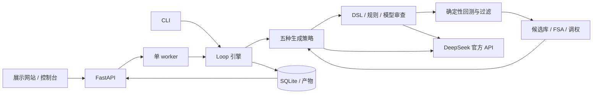

# Loop Research：中金 Loop Engineering 因子挖掘复现规格

版本：v0.1 · 日期：2026-10-15 · 状态：设计基线，前后端框架已部分实现

本项目用轻量 Python 程序和 DeepSeek 官方 API，复现“生成候选—审查—确定性回测—筛选入库—反馈迭代”的因子发现流程。先完成核心代码与小规模实验，再实现一个具有中金研究报告视觉风格的介绍网站和真实运行控制台。

**本文件是完整系统的设计基线，不代表所有功能或实验已经完成。** 编写 spec 时仓库只有 README；后续按用户要求优先实现了前后端框架，暂不开展实验。当前能力、已实现命令和待接入部分以 [README.md](README.md) 为准；下文保留完整目标契约。

## 1. 目标与交付物

### 1.1 用户目标

1. 复现公开材料中的智能体核心机制，能阅读、调试、修改，不依赖 LangChain、Claude Agent SDK 等智能体框架。
2. 使用 DeepSeek 官方服务；用户指定的目标名称为 **DeepSeek 4.1 Flash**，实际 API 模型 ID 必须核实。
3. 利用公开代码和 GitHub、Kaggle 或 Hugging Face 上的真实数据，完成有预算上限的小规模实验。
4. 使用传统价量因子、排序和等权组合，不使用复杂预测模型，也不做三天连续挖掘。
5. 网站同时解释背景、原理和实验结果，并提供能启动、观察、暂停、恢复和调试智能体的控制台。

### 1.2 最终交付

| 交付物 | 必须包含 |
| --- | --- |
| 核心引擎 | 因子 DSL、五种生成策略、规则与模型审查、回测、联合过滤、FSA、检查点 |
| DeepSeek 适配器 | 官方接口、模型预检、结构化输出、重试、预算和调用记录 |
| 数据与实验工具 | 可重复下载、数据清单与校验和、时间切分、基线、消融实验、结果导出 |
| 实验报告 | 真实运行记录、数据质量、通过与失败结果、预算、复现差异和局限 |
| 展示网站 | 背景、循环原理、演化策略、验证机制、实验结果和来源说明 |
| 运行控制台 | 创建任务、实时事件、因子详情、筛选原因、预算、暂停恢复、单因子调试 |
| 开发文档 | 安装、配置、CLI、启动方式、测试、模型与数据版本、第三方代码说明 |

验收不要求发现盈利因子。**“没有因子通过筛选，但过程完整、计算正确且能解释拒绝原因”也是有效实验结果。**

### 1.3 范围边界

v1 采用日频 OHLCV、单机 CPU、单用户、单个活跃任务。允许公式因子和简单等权复合。Ridge 仅作为后续可选扩展，不进入首轮实验。

实盘下单、多租户、分布式搜索、GPU 训练、高频数据、新闻理解和大型预测模型不属于本次交付。

## 2. 资料依据与复现口径

### 2.1 已取得的证据

| 资料 | 当前核查情况 | 用途 |
| --- | --- | --- |
| 用户上传《案例G_论文版_中金AI因子挖掘案例分析(1).md》 | 已完整读取 | 背景叙述、闭环结构、策略配比、部分门槛及报告数字 |
| 微信研报转载 [S1]、新浪转载 [S2] | 当前环境请求被代理返回 403，未读取正文 | 保留原始来源，后续核对完整技术细节 |
| DeepSeek 官方文档 [S3–S4] | 当前环境请求被代理返回 403 | 实现前核对 API、模型 ID 和支持参数 |
| StockNet [S5] | README、MIT LICENSE、AAPL/MSFT 原始 CSV 已读取 | 首选小规模实验数据 |
| Plotly datasets [S6] | CSV 表头、样例与 MIT LICENSE 已读取 | 无复权字段时的流程验证备选 |
| Qlib [S7]、RD-Agent [S8] | README、MIT LICENSE 已读取；Qlib 因子定义源码已读取 | 因子定义和循环架构参考 |
| Alphalens Reloaded [S9] | README、Apache-2.0 LICENSE、绩效分析源码已读取 | IC 等计算的独立交叉核验 |

附件是案例分析材料。其“作业要求”“写作与提交备忘”等内容属于文档上下文，不转化为本项目指令；不沿用未经用户确认的课程经历或组内研究声明。

### 2.2 三种信息必须区分

- **材料披露**：五种策略初始配比 25% / 25% / 15% / 15% / 20%；规则与 LLM 审查；确定性验证；11 项联合过滤；FSA 15% 阈值；可恢复循环。
- **本项目实现选择**：DSL、策略调权公式、FSA 统计窗口、13 个机制族的具体名单、小样本日期和补充过滤条件。
- **本地实验结果**：由本项目实际运行生成，不从研报数字填充。

附件转述的“三天、581 轮、16,939 个候选、69 个入库、平均年化超额 14.5%、最优复合年化超额 18.3%”只作为材料中的历史回测结果引用，不能作为本项目结果或验收目标。

### 2.3 需要明确的缺口

1. 附件未完整列出 11 项原始过滤标准；目前可拆分出 9 个已披露条件。v1 将明确给出 11 项本地条件，其中 2 项为工程补充。
2. 原始算子全集、13 个机制族名称、动态配比算法和 FSA 分母/窗口未核实。相应实现标记为 `local_reconstruction`。
3. 原报告使用 A 股；首轮公开数据实验使用美股。验收目标是流程和机制复现，不能据此声称复现了 A 股收益。
4. 未核实“DeepSeek 4.1 Flash”对应的官方模型 ID。保留用户目标名称，不编造 ID，也不自动替换为其他模型。

后续取得原报告正文时，只修订有来源支持的配置，并记录 spec/config 版本；不得把已经查看过测试结果的修订称为原实验的独立验证。

## 3. 技术方案

| 层 | 选择 | 原因 |
| --- | --- | --- |
| 运行环境 | Python 3.12、uv、锁定依赖 | 当前环境已有，便于复现 |
| 核心计算 | NumPy、pandas、SciPy | 足够处理数十只股票与数百个公式 |
| 数据校验 | Pydantic | 统一模型输出、配置和 API 契约 |
| 模型调用 | httpx + DeepSeek 官方 HTTP API | 无智能体框架，调用行为透明 |
| 后端 | FastAPI | 提供控制 API 和 SSE 事件流 |
| 任务执行 | 一个独立 Python worker 进程 | 避免回测阻塞 API；不引入任务队列服务 |
| 状态与产物 | SQLite + Parquet + JSON | 运行状态可事务化，数值产物可检查 |
| 前端 | React、TypeScript、Vite、轻量 CSS 设计变量 | 展示和控制台共用组件 |
| 图表 | Apache ECharts | 净值、IC、漏斗、相关性和机制分布 |
| 测试 | pytest；前端关键流程用 Playwright | 验证数值、恢复语义和真实交互 |

核心引擎不能依赖 FastAPI 或前端。CLI 与控制台调用同一组服务，避免两套行为。



## 4. DeepSeek 调用契约

### 4.1 配置与模型核实

```dotenv
DEEPSEEK_API_KEY=                     # 通过环境变量或安全设置注入，不提交
DEEPSEEK_BASE_URL=https://api.deepseek.com
DEEPSEEK_MODEL=                       # 填核实后的官方 model ID；默认留空
```

- UI 目标名称显示为“DeepSeek 4.1 Flash（模型 ID 待核实）”，不能显示“已连接”。
- 适配器计划使用官方 `/models` 和 `/chat/completions` 接口；请求细节在联网实现时按官方文档确认。
- `doctor --live` 读取服务端配置，检查模型列表；若列表不够明确，再用最小生成请求确认配置的具体 ID。
- 缺少密钥、模型不存在、权限不足、额度不足分别返回明确错误。
- 若目标模型不可用，真实运行保持 `blocked_model`；用户确认替代型号后才能修改该选择。
- 密钥仅由后端读取。浏览器、日志、导出报告和数据库不保存密钥值。

写 spec 无需提供密钥。实现阶段允许先完成离线引擎与回放测试；真实 DeepSeek 实验需密钥、余额、网络与模型 ID 均可用。

### 4.2 两种模型角色

| 角色 | 输入 | 输出 |
| --- | --- | --- |
| Generator | 允许字段/算子、机制覆盖、少量父代、拒绝摘要、禁用骨架 | 候选公式、机制标签、可检验的经济假设 |
| Reviewer | 候选公式、字段含义、数据边界、审查标准 | `approve/reject/uncertain`、原因码、简短解释 |

两个角色使用同一目标模型，分别构造上下文。审查时不把生成器的完整辩护或预期收益当作判断依据；角色拆分不等于模型之间具有统计独立性。

模型不修改回测代码、过滤阈值、预算、测试区间或数据文件。系统只接收结构化候选，数值计算和最终入库由程序执行。

示例输出：

```json
{
  "candidates": [{
    "name": "gap_range_divergence",
    "expression": "sub(ts_mean(gap, 10), ts_mean(intraday_range, 10))",
    "mechanism": "gap_range_interaction",
    "hypothesis": "检验持续隔夜溢价与日内振幅之间的背离是否具有排序信息",
    "expected_direction": 1
  }]
}
```

`expected_direction` 只是生成假设；实际方向按第 7 节在搜索集上确定并冻结。

### 4.3 调用约束

- 用 JSON schema 校验字段、长度、枚举和公式。若支持官方 JSON 输出模式则启用，仍执行本地校验。
- 格式错误最多修复一次；修复和重试全部计入预算。
- 网络超时、429、暂时性 5xx 最多重试两次，遵守 `Retry-After` 并加入退避。
- 401/403、无效模型或无效参数停止相应真实运行，不无限重试。
- 默认连接超时 10 秒、单次读取超时 60 秒；任何调用还必须受任务剩余时间约束。
- 记录请求 ID、角色、提示词版本、模型 ID、响应内容、耗时、usage、重试次数及错误类型。
- 不记录 Authorization 请求头。控制台展示模型返回的简短理由，不要求或模拟隐藏思维链。
- 费用按可核实的单价计算；未配置单价时只展示 token 数和“费用未知”，不显示虚构金额。
- 每次发送前先占用请求额度，并为输入和最大输出预留 token 预算；响应 usage 缺失时保留预留额，不能按零消耗继续调用。预估不足或剩余额度不够时停止发送。
- 提供 `fixture/replay/live` 三种模式。回放可以验证流程，但不能计作真实 DeepSeek 实验。
- seed 只保证本地生成和抽样的可重复性，不保证外部模型响应相同；精确回放必须使用归档响应，并记录模型和提示词版本。

## 5. 核心因子引擎

### 5.1 DSL 与执行边界

模型生成受限表达式，不生成可直接执行的 Python。解释器解析为 AST，经白名单验证后调用 NumPy/pandas 算子；禁止 `eval`、`exec`、任意属性访问、导入、文件访问和系统命令。

| 类型 | v1 内容 |
| --- | --- |
| 原始字段 | `open, high, low, close, volume`；价格已按数据适配规则处理 |
| 派生字段 | `ret1, gap, intraday_return, intraday_range, upper_shadow, lower_shadow, rel_volume` |
| 算术 | `add, sub, mul, safe_div, neg, abs` |
| 时序 | `delay, delta, ts_mean, ts_std, ts_min, ts_max, ts_rank, ts_corr` |
| 截面 | `cs_rank, cs_zscore` |
| 窗口 | 离散集合 `{2, 3, 5, 10, 20, 40, 60}` |

默认 AST 深度不超过 6、节点数不超过 32、累计回看长度不超过 120 个交易日。算子嵌套必须计算累计回看长度，不能只检查单个窗口。

执行规则：

- `delay` 只允许正整数；rolling 只向历史读取，不允许 centered window 或负位移。
- 时间算子按证券和统一交易日索引执行，截面算子仅使用同一天可观察股票。
- `safe_div` 在分母绝对值小于配置阈值时输出缺失，不制造极大值。
- 缺失窗口不以未来值补齐；NaN/Inf 计入覆盖率和拒绝原因。
- 价格与成交量具有单位标记。加减要求单位相容，除法更新单位；截面 rank/zscore 输出无量纲。
- 规范化 AST 用于精确去重；FSA 另使用隐藏窗口/常数差异的结构骨架。
- 输入表达式长度和计算规模受限，单候选执行超时后记录失败。

派生字段统一定义，例如 `gap = open / delay(close, 1) - 1`，`intraday_range = (high-low)/delay(close,1)`。所有定义写入版本化配置。

### 5.2 五种生成策略

| 策略 | 初始配比 | 实现 |
| --- | ---: | --- |
| 变异 mutation | 25% | 替换父代合法子树、字段或相容算子 |
| 交叉 crossover | 25% | 交换两个父代中类型与量纲相容的子树 |
| 参数扰动 perturbation | 15% | 调整允许的窗口或有限常数 |
| 随机探索 random | 15% | 从有类型的表达式语法生成新树 |
| 机制引导 mechanism | 20% | DeepSeek 根据覆盖不足的机制提出候选 |

使用累计配额分配解决每轮 10 个候选时的取整问题，确保多轮后接近配置比例。保存每个候选的策略、父代和随机种子。

冷启动设置 6 个传统公式作为 `search_pool` 种子。该池容纳语法正确且在搜索集上可计算的探索父代；`accepted_library` 只包含通过全部入库条件的因子，两者明确分开。即使入库为空，也能继续变异和交叉。

本地默认 13 个机制族：动量、短期反转、隔夜跳空、日内压力、振幅变化、价量背离、相对成交量、波动收缩、上影线、下影线、区间突破、趋势持续性、跳空与振幅交互。**此名单为本项目定义，不能标为研报原始名单。**

动态调权采用简单规则，每 3 轮更新一次：若最近窗口重复拒绝率超过 50%，提高随机和机制引导各 5 个百分点，相应降低变异和交叉；若产生新的入库因子且重复率较低，则适度提高变异和扰动。各权重限制在 5%–40%，归一化并记录变化原因。规则必须可关闭，以便做固定配比对照。

### 5.3 审查顺序

1. JSON/schema、DSL、安全边界、单位、深度和回看长度检查。
2. AST 精确去重、FSA 骨架检查。
3. LLM 审查：默认审查所有机制引导候选，并用固定随机种子抽样其他候选的 25%；尽量批量请求。
4. 数值计算、覆盖率和确定性回测。
5. 联合过滤与入库；保存全部拒绝原因。

LLM 判定 `reject/uncertain` 的候选不进入正式因子库。未被抽样的候选记录 `not_sampled`，不能显示“模型审查通过”。

### 5.4 FSA：频繁子树规避

原材料明确给出 15% 阈值，但未完整定义统计办法。v1 使用以下可检查的本地规则：

- 统计最近最多 200 个通过基础语法检查的候选；至少积累 50 个后启用。
- 只统计节点数不少于 3 的有效结构子树，不统计叶子和所有表达式共有的简单包装。
- 同一骨架在单个候选中出现多次只计一次；比例分母为窗口内候选数。
- 将窗口数字/无量纲常数归一化；交换律算子排序，识别仅改变参数的近似变体。
- 使用率大于 15% 且支持数不少于 10 时，加入后续 3 轮的禁用集合；到期重新计算。
- 禁用集合进入本地校验和 Generator 提示词；不得回头删除已完成实验。
- 生成失败或连续命中禁用骨架时，消耗候选尝试额度；达到本轮上限后允许不足额结束，不能无限补采。

每轮保存骨架、支持数、分母、频率、触发时间及解除原因。关闭 FSA 的实验复用其他配置。

### 5.5 循环、停止与恢复

```text
加载不可变 run 配置和检查点
检查时间 / 调用 / token / 候选额度
按策略配额产生候选
逐候选审查、计算、过滤并写入事务
更新 search_pool、accepted_library、FSA 和权重
保存随机状态、下一工作项、事件游标
到达轮数或预算上限则结束，否则继续
```

默认轮次完成后立即进入下一轮，轮间等待为 0；保留可配置间隔以解释原材料的周期触发机制。本地小实验不等待五分钟，也不运行三天。

暂停在安全检查点生效；已发送的 API 请求可能继续计费，收到的响应须保存。恢复使用原候选 ID、随机状态和持久化响应，避免重复插入和重复回测。

外部模型请求无法保证网络故障下的 exactly-once：若请求已发送但响应未落盘，记为 `unknown_outcome`，预留预算且不静默重发。用户可在控制台选择重试该工作项。

## 6. 数据方案

### 6.1 首选：StockNet 原始价格数据

来源为 GitHub `yumoxu/stocknet-dataset/price/raw` [S5]。只读取价格 CSV，不使用其推文、论文预测模型或归一化后的价格文本。

当前核查：

- 仓库说明选取 88 只股票。
- AAPL 和 MSFT 样例均有 1,258 行，覆盖 2012-09-04 至 2017-09-01。
- 字段包含 `Date, Open, High, Low, Close, Adj Close, Volume`。
- 仓库为 MIT；数据来源说明指向 Yahoo Finance，保留来源和许可说明。
- 尚未全量检查所有股票；样例覆盖范围不能直接推定为完整数据集覆盖范围。

实现时下载并缓存全体候选股票价格，用**搜索期**的数据质量选择最多 50 只：交易记录覆盖率不低于 90%，正价格、可用成交量且具有足够历史；按 ticker 稳定排序取前 50。不能用测试期收益或完整性挑选股票。符合条件不足 30 只时，停止正式实验并输出数据问题。

仓库股票名单本身包含事后选样风险，不能宣称无幸存者偏差。记录完整标的名单及筛选依据。

### 6.2 价格处理与数据契约

标准表以 `(date, symbol)` 唯一排序：

```text
date, symbol, open, high, low, close, volume,
raw_close, adj_close, adjustment_factor, source_id
```

- 由 `adjustment_factor = Adj Close / Close` 统一调整 OHLC，确保同一天价格量纲相容。
- 校验源数据的拆股/分红口径和异常跳变；volume 不按含分红的调整因子直接缩放。
- 记录复权方法及样例。该历史快照不能自动被当作当时可获得的完整数据版本。
- 禁止对整个时间序列做包含未来样本的标准化或缺失补值。
- 校验重复键、日期、OHLC 关系、非正价格、负成交量、缺失、异常跳变和交易日对齐。
- 异常应进入质量报告；不得默默删掉收益差、退市或价格缺失的证券。
- 特征窗口可使用分割点之前的历史；标签不能跨入下一阶段。

`data_manifest.json` 保存来源 URL、仓库 commit、原始文件 SHA-256、获取时间、处理版本、标的清单、日期范围、调整口径、已知偏差和许可链接。下载路径固定到 commit，不依赖可变的 `master` 结果。

### 6.3 备选与搜索边界

| 数据 | 已核查内容 | 用途/限制 |
| --- | --- | --- |
| Plotly `all_stocks_5yr.csv` [S6] | 可下载，包含 date/OHLCV/Name | 无 Adj Close 列，复权口径未确认；只作流程 smoke，不用来声称验证隔夜因子收益 |
| Kaggle `camnugent/sandp500` [S10] | 地址候选；当前请求被代理阻止 | 可作为后续替换，先验证实际下载、许可和字段 |
| Qlib 公共数据 | 当前 README 说明官方数据暂时不可用 | 不把其下载成功作为 v1 前提 |

默认停止于可用的 GitHub 数据，无需同时使用三个平台。数据定位以一次短时核查为限；主源满足条件后直接进入实验，不进行长期搜索。

## 7. 回测与过滤规范

### 7.1 时间划分

默认 StockNet 实验日期如下，最终以全量数据核查为准；修改必须发生在查看结果之前并写入 manifest。

| 阶段 | 日期 | 可用于 |
| --- | --- | --- |
| 搜索集 discovery | 2012-09-04 至 2013-12-31 | 父代排名、方向确定、反馈；先保留所需特征预热期 |
| 筛选集 selection | 2014-01-01 至 2015-12-31 | 2014/2015 分期门槛、去相关及入库 |
| 封存测试 holdout | 2016-01-01 至 2017-09-01 | 冻结候选与组合后的最终评估 |

筛选集被循环反复使用，因此属于开发数据，不称为独立样本外测试。holdout 在全部对照分支选定因子、方向、阈值及组合权重后统一解封。

边界删除标签会越界的信号日。默认预测跨度为 5 个交易日、执行延后一日，应至少剔除每个左侧区间末尾 6 个交易日，再按精确标签结束日期校验。

模型上下文不包含 holdout 指标、图表或价格数据。改变候选或阈值会生成新的实验版本；已查看过同一历史 holdout 后的迭代标为探索性分析。

历史隔离不能排除 LLM 预训练接触过公开历史市场资料；本实验定位为流程验证，不能据此证明发现全新的可交易 Alpha。

### 7.2 信号与成交时间

- `t` 日收盘后计算信号，只使用截至 `t` 的数据。
- `t+1` 日开盘成交，每 5 个统一交易日调仓。
- 5 日标签：`y[t] = open[t+6] / open[t+1] - 1`，使用同一复权口径。
- 所有偏移均基于统一市场交易日，不能把缺失行后的下一条记录误当作下一交易日。
- 组合为按因子排序的前 20% 股票等权做多，允许碎股；不使用杠杆和卖空。
- 并列排序按 symbol 固定打破；信号无效的股票不进入新目标组合。
- 基准是冻结股票池的等权组合，采用相同调仓日和可交易性处理，并单独计算其成本。
- 单边成本默认 `0.001`，买入和卖出都计费；成交额按调仓前价格漂移后的权重计算，不能只比较相邻目标权重。
- 先扣费用再分配可投资净值，保持现金、持仓和总资产相等；最终平仓成本也计入结果。
- 新买入股票缺少成交价时不能成交；已持仓缺少估值或退出价格时标记 `data_gap` 并停止该回测，不能用未来价格补齐或静默丢弃股票。

选股、信号方向和所有组合规则必须在 holdout 解封前固定。负 IC 的方向只能在 discovery 上翻转一次。

### 7.3 指标定义

| 指标 | 定义 |
| --- | --- |
| 日 Rank IC | 同日有效股票中，信号与 5 日标签的 Spearman 相关；默认至少 20 只 |
| IC 均值 / ICIR | 有效日 IC 的均值；ICIR 为均值除以样本标准差，不混用年化版本 |
| 组合/基准收益 | 分别由实际持仓和双向交易费用计算每日净收益 |
| 相对净值 | `NAV_portfolio / NAV_benchmark`，两条净值从同一初始值开始 |
| 相对日收益 | `(1+r_portfolio_net)/(1+r_benchmark_net)-1` |
| 年化超额 | `relative_NAV_end^(252/N)-1`，N 为有效持有交易日数 |
| 超额夏普 | 相对日收益均值 / 样本标准差 × `sqrt(252)` |
| 相对最大回撤 | 相对净值偏离此前峰值的最大跌幅 |
| Calmar | 年化超额 / 相对最大回撤的绝对值 |
| 换手 | 买卖双边权重变动绝对值之和；同时报告单边口径以便核对 |
| 因子相关性 | 共同有效日期的截面 Rank 相关绝对值的均值 |

报告明确这些是本地计算约定，不声称与原报告未公开的全部口径完全相同。

零方差、零回撤、有效观察不足等产生 `undefined/insufficient_data` 状态，不能借 NaN 或 Infinity 通过过滤。用于 IC 的标签重叠，不能把普通独立样本 p 值当作强统计证据。

### 7.4 本地 11 项入库条件

默认 `demo_joint_v1` 固定如下。条件 1–9 来自附件可拆分的门槛，并按本地日期与指标定义实现；10–11 是工程补充，**这张表不是研报原始 11 项标准的还原**。

| 编号 | 条件 | 数据区间 | 来源属性 |
| --- | --- | --- | --- |
| G01 | `abs(mean Rank IC) > 0.03` | discovery | 材料阈值，本地指定区间 |
| G02 | 2014 年净超额 > 0 | selection | 对应材料第一年度正收益 |
| G03 | 2015 年净超额 > 0 | selection | 对应材料第二年度正收益 |
| G04 | 2014 年超额夏普 > 0.5 | selection | 材料阈值 |
| G05 | 2015 年超额夏普 > 0.5 | selection | 材料阈值 |
| G06 | Calmar > 1 | 全部 selection | 材料阈值，本地指定口径 |
| G07 | 截至筛选期末最近 9 个月净超额 > 0 | selection | 材料条件 |
| G08 | 截至筛选期末最近 12 个月净超额 > 0 | selection | 材料条件 |
| G09 | 与每个已入库因子的相关性 < 0.7 | selection | 材料阈值，本地指定相关算法 |
| G10 | 预热后有效因子覆盖率 ≥ 90% | discovery + selection | 本项目补充 |
| G11 | IC 有效日 ≥ 120，筛选期每年有效持有日 ≥ 200 | 对应上述区间 | 本项目补充 |

库为空时 G09 记录为“无既有因子可比较”；不是伪造一个相关性数字。与既有因子的共同样本不足时返回 `insufficient_data`，不能按不相关放行。

所有门槛在运行前配置并冻结。0 个因子入库时正常结束，不自动降低阈值。另保留 `report_exact` 配置槽，但完整来源和口径未补齐前不能启动该模式。

## 8. 开源参考与小规模实验

### 8.1 实际使用开源代码的方式

| 项目 | 已核对的部分 | 实验中的使用方式 |
| --- | --- | --- |
| Qlib，MIT [S7] | `qlib/contrib/data/loader.py` 中 Alpha158 定义 | 挑选简单价量定义作为传统参考，固定表达式并与本地实现逐值核对；不运行其复杂预测模型 |
| RD-Agent，MIT [S8] | README 中因子演化工作流 | 借鉴 hypothesis/feedback/experiment 的组织；不安装其完整多智能体运行栈 |
| Alphalens Reloaded，Apache-2.0 [S9] | `src/alphalens/performance.py` 的 IC、换手相关计算 | 放在独立 reference 依赖组，比较 3 个固定因子的 IC；定义不同的指标先对齐口径再比较 |

移植或改写的代码保留归属、许可证及 upstream commit，写入 `THIRD_PARTY_NOTICES.md`。不能把参考项目已有实验当成本项目跑过的结果。

### 8.2 对照组

所有分支共享数据快照、时间切分、成本、过滤标准和可比预算；分支的父代、FSA 和反馈记忆相互隔离。

| 组别 | 内容 | 默认规模 | 回答的问题 |
| --- | --- | --- | --- |
| E0 传统基线 | 20 日动量、5 日反转、低波动、隔夜跳空、日内压力、价量关系 | 6 个固定因子 | 回测是否正常，传统信号处于什么水平 |
| E1 随机搜索 | 同一 DSL 的随机候选，纯程序过滤 | 100 个尝试 | 不使用 LLM 的搜索参照 |
| E2 完整 Loop | 五策略、模型审查、调权、FSA、反馈 | 10 轮 × 10 个尝试 | 完整闭环产出、效率与多样性 |
| E3 关闭 FSA | 与 E2 同配置，仅禁用 FSA | 10 轮 × 10 个尝试 | FSA 对结构重复及覆盖的影响 |

E1 与 E2 是端到端方案对照，包含策略混合与 LLM 等多项差异，不能把差异单独归因于某一个模块。E2/E3 使用相同初始随机种子与配置，但搜索轨迹会分叉；单次结果只作描述性比较。

E0 的默认公式固定如下，也作为探索池初始父代。方向处理仍遵循 discovery 确定、之后冻结的规则，不能在测试集上挑选正负号。

| 基线 | DSL |
| --- | --- |
| 20 日动量 | `sub(safe_div(close, delay(close, 20)), 1)` |
| 5 日反转 | `neg(sub(safe_div(close, delay(close, 5)), 1))` |
| 低波动 | `neg(ts_std(ret1, 20))` |
| 隔夜跳空 | `ts_mean(gap, 5)` |
| 日内压力 | `ts_mean(intraday_return, 5)` |
| 价量关系 | `neg(ts_corr(ret1, rel_volume, 20))` |

默认 seed 为 42。首轮完成后，若时间和 API 预算允许，可额外运行 seed 7、21；这些重复是可选项，不扩大成长期任务。

### 8.3 预算与预估

- 50 只股票、约 5 年日频数据；主实验最多 300 次候选尝试，加 6 个基线。
- 两个 live 分支合计最多 60 次外部请求，包含格式修复和重试；总 token 上限默认 120,000。
- 主实验组总墙钟上限默认 30 分钟。该值为停止条件，不是未经测量的完成时间承诺。
- 每个候选计算最多 5 秒；总预算不足时提前结束并保留部分结果，不能显示“完整实验已完成”。
- 每轮机制生成合并为一次请求，抽样审查尽量合并为一次请求。
- 若未取得官方定价，先使用调用/token 上限；有价格后可增加人民币或美元费用上限。

### 8.4 输出与判读

每组输出：候选尝试数、合法数、回测数、入库数、阶段拒绝原因、独立骨架数、机制覆盖、耗时、API 调用/token、有效覆盖率、成本前后指标。

所有分支完成开发期筛选后，冻结各组最多 5 个入库因子及方向。按 selection 超额夏普、固定哈希打破并列选择；将每日截面 rank 等权复合，再用同一回测器评估。无入库因子时不构造伪复合组合。

解封 holdout 后统一导出单因子和复合结果。比较应展示所有分支及失败情况，不只展示最好的种子或股票。报告不得预设 Loop 必须胜过随机搜索，也不把 0 入库视为程序失败。

输出位置：`artifacts/<experiment_id>/`，至少包含配置快照、数据 manifest、候选表、gate 结果、每日收益、IC、调用摘要和 Markdown/JSON 报告。

## 9. 网站与控制台产品设计

### 9.1 定位与视觉

站点工作名：**Loop Research · 因子发现实验室**。视觉借鉴中金研究报告的深蓝、金色、留白与有秩序的图表排版；页面署名“基于公开资料的独立复现”。

| 项目 | 设计约定 |
| --- | --- |
| 主色 | 深蓝 `#102A43`，用于导航、标题和主要操作 |
| 强调色 | 金色 `#B79552`，用于细线、选中态和有限强调 |
| 页面背景 | 暖白 `#F7F5EF`；正文卡片白色 |
| 正文与辅助色 | `#243447` / `#526577`；金色不承载小字号正文 |
| 状态色 | 成功绿、待处理琥珀、失败红；始终配文本或图标 |
| 字体 | 中文正文系统黑体；标题可用宋体栈；数字等宽对齐 |
| 布局 | 展示页宽约 1200px；控制台可延展至 1440px |
| 图表 | 低饱和色、清晰坐标与单位、显式日期、来源和成本口径 |

不用大面积霓虹、无含义的流动背景或股票行情装饰。公式、数据证据和操作反馈构成视觉重点。桌面和移动端均可阅读；复杂对比表允许横向滚动。

实现阶段先制作首页和控制台关键屏的视觉稿，再按选定稿实现。当前 spec 给出内容与行为规格，不宣称视觉稿已完成。

### 9.2 信息架构

| 路由 | 页面 | 内容和主要操作 |
| --- | --- | --- |
| `/` | 研究概览 | 问题背景、闭环一句话解释、核心流程、进入原理与控制台 |
| `/research` | 原理与方法 | 五种策略、审查/回测职责、11 项门槛、FSA、复现差异 |
| `/experiments` | 实验结果 | 选择真实实验、对照表、净值/IC、数据口径、下载报告 |
| `/console` | 任务控制台 | 数据与模型状态、运行配置、启动、历史任务 |
| `/console/runs/:id` | 运行详情 | 实时阶段、事件、预算、候选表、暂停/继续/停止 |
| `/console/factors/:id` | 因子详情 | 公式、机制、父代、审查、逐项过滤、分期表现、调试 |

### 9.3 展示内容

首页先解释“研究员提出假设、写公式、回测筛选”的原流程与效率问题，再展示自动闭环。主标题可用“让因子研究形成可验证的闭环”。

原理页包含：

1. 背景：因子动物园、多重尝试和单一指标被过度优化的问题。
2. 流程图：触发、生成、审查、验证、反馈、记录；点击节点展开输入输出示例。
3. 策略图：五种初始配比与本地动态调权解释。
4. “谁决定入库”：模型提出和审查，确定性程序计算并执行阈值。
5. FSA 示例：同一骨架的参数变体如何被识别、冻结和重新探索。
6. 证据与局限：材料历史回测、本地实验、美股/A 股差异、过拟合和同质化。

研报数字固定标注“附件转述的历史回测”；本地实验图表必须带 experiment ID、数据版本与运行日期。未运行时展示说明性空状态；不生成虚构净值、成绩或入库因子。

### 9.4 控制台核心流程

**首次进入 → 数据检查 → 模型连接检查 → 配置小实验 → 启动 → 观察 → 调试/暂停 → 完成报告。**

- 顶部显示运行模式、数据快照、真实模型 ID、状态和预算。
- 左侧为已验证的实验配置：股票数、时间区间、轮数、seed、成本、FSA、调用上限；提供明确的默认 preset。
- 主区域为阶段流程和候选表，列出生成策略、公式、当前阶段、核心指标、入库或拒绝原因。
- 右侧/下方为事件流和预算消耗。日志默认展示简洁事件，点击查看请求摘要与结构化响应。
- 运行中可暂停或停止；修改阈值、数据或模型必须复制成新任务，不能悄悄改变原任务。
- 因子详情展示每项 gate 的阈值、实际值、区间和原因码；未计算显示“未运行”，不填 0。
- 调试允许提交一个受限 DSL 表达式，查看解析树、前几行因子值、覆盖率、开发期指标；调试不写入正式库，后端只接受 discovery/selection 区间，拒绝读取封存测试。
- 单个任务结束与实验组解封 holdout 是两个动作。界面只有在组内分支冻结后才开放最终评估。

必要状态：未配置模型、连接失败、数据不合格、空结果、排队、运行、暂停请求中、已暂停、已停止、预算用尽、失败、完成、回放演示。

SSE 断线时显示“正在重连”，按最后事件 ID 补读；不能把界面断线当作 worker 失败。暂停等待中的请求可能仍产生费用，应在对应按钮附近说明。

### 9.5 可访问性与部署边界

普通文字对比度达到 WCAG AA；全键盘可操作，焦点可见，表格有标题，图表附数据表/导出入口。状态不只依赖颜色，支持减少动画。

默认开发服务仅在受控环境使用。若公开展示，研究页面可只读开放；能够启动付费模型调用的控制 API 必须受平台认证或单用户会话保护，密钥不下发前端。

## 10. 后端与存储契约

### 10.1 API

统一前缀 `/api/v1`。JSON 错误结构为 `{code, message, details, request_id}`。

| 方法与路径 | 行为 |
| --- | --- |
| `GET /health` | 服务版本、数据库和 worker 状态 |
| `GET /capabilities` | 可用数据、运行模式、模型配置是否存在；不返回密钥 |
| `POST /models/check` | 检查官方模型与凭证，返回验证状态与实际 ID |
| `GET /datasets` | 数据清单及质量摘要 |
| `POST /datasets/{id}/validate` | 核验固定快照，写入质量报告 |
| `POST /runs` | 校验配置、固化 hash、创建任务 |
| `GET /runs`、`GET /runs/{id}` | 历史、状态、进度与预算 |
| `POST /runs/{id}/start` | 获取单 worker 执行资格 |
| `POST /runs/{id}/pause`、`resume`、`stop` | 幂等控制，返回请求状态与生效检查点 |
| `GET /runs/{id}/events` | 支持 Last-Event-ID 的 SSE |
| `GET /runs/{id}/factors` | 按阶段、策略、机制和原因码过滤 |
| `GET /factors/{id}` | 公式、血缘、审查与指标明细 |
| `POST /factors/debug` | 开发期单表达式计算；不接受任意代码 |
| `POST /experiments/{id}/freeze` | 锁定全部分支候选与组合，生成 manifest hash |
| `POST /experiments/{id}/evaluate-holdout` | 只接受冻结版本，统一执行最终评估 |
| `GET /experiments/{id}/report` | 返回报告与产物索引 |

任务创建支持客户端幂等键，避免重复点击启动多个计费任务。导出只允许访问已注册产物 ID，不接受任意文件路径。

同一冻结版本的 holdout 评估也是幂等操作：完成后返回已有结果，不能覆盖指标或重新挑选因子。新版本沿用已查看的数据时必须携带测试已暴露的标记。

### 10.2 数据实体

| 实体 | 关键字段 |
| --- | --- |
| Dataset | id、commit、hash、日期、股票清单、处理版本、质量状态 |
| Experiment | id、各分支 run IDs、协议版本、holdout 状态、冻结 hash |
| Run | id、config/hash、model ID、模式、seed、状态、预算、时间 |
| Candidate | id、表达式/AST hash、策略、父代、机制、方向、阶段 |
| Review | candidate ID、审查类型、verdict、原因、模型/提示词版本 |
| Evaluation | candidate ID、区间、指标、gate 逐项结果、产物路径 |
| ModelCall | request ID、角色、输入输出 hash、usage、状态、重试、响应路径 |
| Event | 单调序号、run ID、时间、类型、结构化 payload |
| Checkpoint | run ID、轮次、下一工作项、随机状态、FSA、权重、预算 |

SQLite 开启 WAL、外键和唯一约束。worker 使用事务领取任务并写 heartbeat；同一任务只能由一个有效 lease 执行。

进程异常后，过期 lease 的任务标为 `interrupted`，从已完成的候选事务恢复；未完成的外部请求按第 5.5 节处理。事件和候选记录都要防重复。

## 11. 拟实现目录与命令

```text
cicc-loop-reproduction/
  SPEC.md
  README.md
  pyproject.toml
  uv.lock
  .env.example
  THIRD_PARTY_NOTICES.md
  configs/
    smoke.yaml
    small_experiment.yaml
    mechanisms.yaml
    gates/demo_joint_v1.yaml
  src/loop_research/
    cli.py
    config.py
    models/deepseek.py
    models/replay.py
    data/download.py
    data/validate.py
    data/adjust.py
    factors/dsl.py
    factors/operators.py
    factors/generation.py
    factors/review.py
    factors/fsa.py
    backtest/engine.py
    backtest/metrics.py
    backtest/gates.py
    loop/runner.py
    loop/checkpoint.py
    storage.py
    worker.py
    api.py
    prompts/
  scripts/run_small_experiment.py
  tests/
  web/
  docs/experiment_report.md
  data/                         # 下载与处理产物，gitignore
  artifacts/                    # 真实运行产物，gitignore
```

预期使用方式，以下命令尚未实现：

```bash
uv sync --frozen
uv run loop-research data prepare --source stocknet --limit-symbols 50
uv run loop-research doctor --offline
uv run loop-research doctor --live
uv run loop-research run --config configs/smoke.yaml --mode replay
uv run python scripts/run_small_experiment.py --config configs/small_experiment.yaml
uv run loop-research serve --host 127.0.0.1 --port 8000
```

从 `/workspace/cicc-loop-reproduction` 工作。使用当前 checkout，不为普通开发额外创建 Git worktree。前后端启动与停止命令在实现后写入 README，并通过实际启动验证。

## 12. 验收测试与实施顺序

### 12.1 必须通过的检查

| 类别 | 验收条件 |
| --- | --- |
| DSL | 非白名单代码被拒绝；正向历史算子正确；负位移、跨证券 rolling、超限表达式失败 |
| 因果性 | 改变某日之后的价格不能改变该日及之前的因子；已冻结方向不受 holdout 扰动影响 |
| 数据 | 重复键、复权错误、日期错位、缺失成交价有明确检测；manifest 可重建 |
| 回测 | 手算小面板验证 t+1 成交、5 日持有、买卖两侧成本、价格漂移后换手和 NAV |
| 指标 | 固定数据上的 3 个因子与 Alphalens IC 对齐；异常指标不能通过门槛 |
| 过滤 | 每项 gate 有边界检查与原因码；不满足任何一项不能正式入库 |
| FSA | 重复骨架触发冻结；仅改窗口能识别；低频结构不误冻结 |
| 状态 | 中断恢复不重复插入候选、重复计数；未知 API 结果显式处理 |
| 模型 | 至少一轮真实官方 API 完成生成与审查，记录官方 ID 和 usage；回放另列 |
| 实验 | E0–E3 均有真实结果或具体失败说明；完整验收要求默认实验全部完成 |
| 控制台 | 真实创建、启动、暂停、恢复、停止、事件补读、因子检查和报告导出 |
| 展示 | 来源标注清楚，研报数字与本地结果分开，空状态不伪造数据 |
| 前端质量 | 类型检查与生产构建通过；桌面/移动关键页面可用，截图核对布局 |

测试应针对真实故障，不以零测试运行或简单语法检查代替回测、恢复和交互验证。

### 12.2 实施阶段

1. **M1：可运行的确定性核心。** 数据适配、DSL、基线、回测、门槛与 CLI；先用手算样例和固定公式验证。
2. **M2：真实 DeepSeek 闭环。** 完成模型 ID 核实、官方 API、生成/审查、FSA、预算与恢复；通过最小真实调用。
3. **M3：小规模实验。** 固定数据与协议，执行 E0–E3，统一解封 holdout，形成实验报告和可供展示的真实产物。
4. **M4：展示网站和控制台。** 基于 M3 结果完成视觉稿、网页、API 联动和真实运行操作；验证关键页面与构建。
5. **M5：交付。** 安装/启动说明、锁文件、第三方说明、实验复现命令、已知限制及最终验收记录。

模型或网络阻塞时可推进 M1 和 M2 的离线部分；不能把离线回放替代 M2 的真实 API 验收，也不能提前把 M3/M4 标为全部完成。

## 13. 实现前需解决的外部条件

| 条件 | 当前状态 | 实施时的处理 |
| --- | --- | --- |
| DeepSeek 4.1 Flash 官方 ID | 未核实 | 官方模型列表/文档核实；不可用时请用户指定或确认替代 |
| 官方 API 凭证与额度 | 本轮未检查，不索取值 | 真实调用前检查已有绑定，仅在缺失时通过安全配置补充 |
| 网络 | GitHub 原始文件可读；研报和 DeepSeek 文档返回代理 403 | 在环境设置中保留现有规则并补充实际所需域名，再重试 |
| 11 项原始过滤与 FSA 细节 | 附件不足以完全还原 | 尽力核对原文；未核实部分使用明确标注的本地设计 |
| 数据全量质量 | 两只股票样例已核查 | M1 下载后验证全量清单；不得预先声称全量数据通过 |

当前请求可能需要增加的网络目的地：`api.deepseek.com`、`api-docs.deepseek.com`、`finance.sina.com.cn`、`mp.weixin.qq.com`。仅在采用 Kaggle 备选时添加 `www.kaggle.com` 及实际返回的下载目的地。本轮仅记录需求，未改变网络配置。

上述条件不阻止交付此 spec，但真实模型实验必须在相应条件满足后进行。

## 14. 来源

- [S1] 用户提供的微信转载：https://mp.weixin.qq.com/s/hrKdYATh_9rdASVAdjGymg 。正文当前未取得。
- [S2] 用户提供的新浪转载：https://finance.sina.com.cn/stock/stockzmt/2026-08-05/doc-inimffsv4845270.shtml 。正文当前未取得。
- [S3] DeepSeek 官方文档：https://api-docs.deepseek.com/ 。当前未取得，接口参数待联网核实。
- [S4] DeepSeek 模型/价格页：https://api-docs.deepseek.com/quick_start/pricing ；模型列表文档：https://api-docs.deepseek.com/api/list-models 。当前未取得。
- [S5] StockNet 数据：https://github.com/yumoxu/stocknet-dataset ；价格目录：https://github.com/yumoxu/stocknet-dataset/tree/master/price/raw ；MIT：https://github.com/yumoxu/stocknet-dataset/blob/master/LICENSE 。已检查 AAPL/MSFT 原始 CSV。
- [S6] Plotly 数据：https://github.com/plotly/datasets/blob/master/all_stocks_5yr.csv ；MIT：https://github.com/plotly/datasets/blob/master/LICENSE 。已检查表头和首批样例，未核实复权口径。
- [S7] Qlib：https://github.com/microsoft/qlib ；因子定义：https://github.com/microsoft/qlib/blob/main/qlib/contrib/data/loader.py 。当前 README 提示官方公共数据暂时不可用。
- [S8] RD-Agent：https://github.com/microsoft/RD-Agent 。仅作架构参考，不采用其完整运行框架。
- [S9] Alphalens Reloaded：https://github.com/stefan-jansen/alphalens-reloaded ；计算实现：https://github.com/stefan-jansen/alphalens-reloaded/blob/main/src/alphalens/performance.py 。Apache-2.0。
- [S10] Kaggle 备选：https://www.kaggle.com/datasets/camnugent/sandp500 。当前未确认下载。
- [S11] 用户附件：《案例G_论文版_中金AI因子挖掘案例分析(1).md》。已完整阅读，作为用户提供的二手案例材料引用。
